  

  

  
  
  
  

---

## 👨‍💻 Sobre mí

Soy **desarrollador Full Stack** formado en la **Facultad de Informática de la UNLP** (La Plata, Argentina). Me gusta construir productos completos: desde la interfaz en **React / Next.js** hasta la API, la base de datos y el despliegue con **Docker** en la nube.

Además tengo experiencia en **proyectos de I+D universitarios** (LIDI, LINTI, LIFIA) donde llevé modelos de **Inteligencia Artificial** a aplicaciones reales: visión por computadora, NLP, aprendizaje por refuerzo y LLMs locales.

- 🔭 Trabajando en apps web full stack con integración de **IA / LLMs**
- 🧠 Base sólida en algoritmos: **programación competitiva (ICPC / CSES) en C++**
- 🤝 Busco un puesto **Full Stack** donde aportar producto de punta a punta
- ⚡ Fun fact: entrené un autito para que maneje solo 🚗

---

## 🛠️ Stack tecnológico

**Frontend**

  

**Backend**

  

**Bases de datos**

  

**DevOps & Cloud**

  

**IA, algoritmos y más**

  

  
  
  
  
  
  
  
  

---

## 🚀 Proyectos destacados

| Proyecto | Descripción | Tecnologías |
|---|---|---|
| 🗂️ **[file-to-text](https://github.com/Nack34/file-to-text)** | App full stack que extrae texto de PDFs, imágenes (OCR), Word y Excel, lo indexa para búsqueda y lo consulta con un LLM local vía servidores MCP. | `FastAPI` `Python` `JS` `Elasticsearch` `Ollama` `MCP` `Docker Compose` |
| ♻️ **[Estación de residuos inteligente](https://github.com/Nack34/ProyectoLINTI-Contenedores_inteligentes-UNLP)** | Proyecto de I+D (LINTI – UNLP): plataforma web + API que clasifica residuos con una red neuronal convolucional para un contenedor inteligente. | `Django` `REST API` `CNN` `JS` `Docker` |
| 💬 **[ProyectoLIFIA-NLP](https://github.com/Nack34/ProyectoLIFIA-NLP)** | Servicio web de Procesamiento de Lenguaje Natural desarrollado en el LIFIA (UNLP). | `FastAPI` `Python` `NLP` `Conda` |
| 🚗 **[TinyML · Autito autónomo](https://github.com/Nack34/ProyectoLIDI-TinyML-Autito-UNLP)** | Proyecto LIDI – UNLP: IA en sistemas embebidos de bajos recursos; un auto que aprende a manejarse solo, con simulación en Unity. | `TinyML` `C#` `Unity` `ML` |
| ✊ **[Piedra, papel o tijera con IA](https://github.com/Nack34/pps-piedra-papel-tijera)** | Reconocimiento de gestos de la mano con visión por computadora usando modelos YOLO11 de detección y pose. | `Python` `YOLO11` `Computer Vision` `Poetry` |
| 🤖 **[test_mcp](https://github.com/Nack34/test_mcp)** | Experimentos con servidores **Model Context Protocol** y visión por computadora conectados a LLMs locales. | `Python` `MCP` `Ollama` `Docker` |
| 🎮 **[RLProject](https://github.com/Nack34/RLProject)** | Agente de aprendizaje por refuerzo que aprende a jugar al Ta-Te-Ti, con tests y gestión con Poetry. | `Python` `RL` `Poetry` `Pytest` |
| 🏆 **[CSES Problems](https://github.com/Nack34/CSES---Problems)** | Soluciones a la CSES Problem Set: estructuras de datos, grafos, DP y más. | `C++` `Algoritmos` |

<!-- ➕ Para agregar un proyecto nuevo, copiá una fila de la tabla:
| 🧩 **[nombre](https://github.com/Nack34/nombre)** | Qué hace y qué problema resuelve. | `React` `Node.js` `PostgreSQL` |
-->

---

## 📊 Actividad en GitHub

  

---

  <b>¿Tenés un proyecto o una búsqueda Full Stack?</b> Escribime a <a href="mailto:ricciardinicolas75@gmail.com">ricciardinicolas75@gmail.com</a> 📬

  

